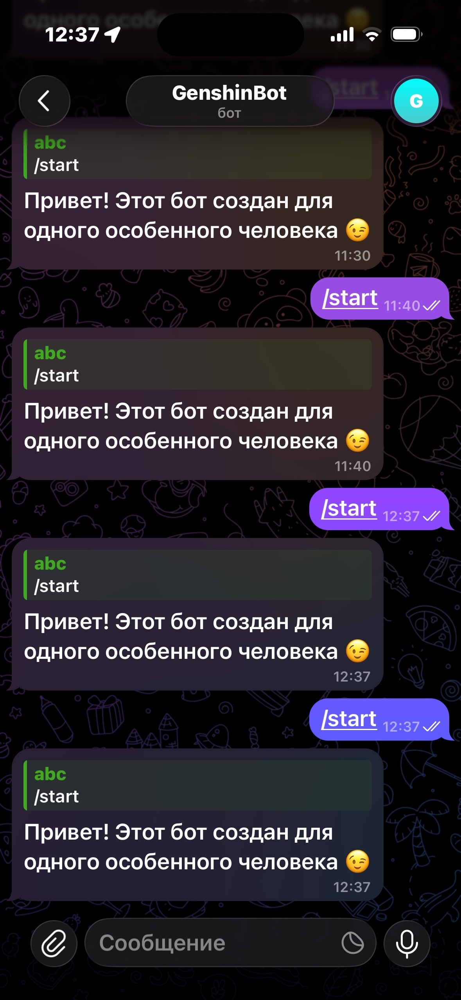

# 💌 Telegram-бот «Утренние сообщения» (приватный проект)

Персональный Telegram-бот, который каждый день присылает романтичные 
сообщения одному конкретному человеку. Работает **круглосуточно** в 
облаке, не засыпает благодаря системе мониторинга.

> 🔒 Бот создан для приватного использования. Доступ к получению 
> сообщений ограничен одним Telegram-ID.

---

## 🚀 Что умеет бот

- **Ежедневная отправка сообщений в 08:00 (МСК)** — случайное сообщение 
  из заранее заданного списка.
- **Ограничение получателей** — сообщения получает только один человек 
  (ID задан в коде). Остальные пользователи видят приветственное сообщение 
  и не могут подписаться на рассылку.
- **Health Check** — эндпоинт `/health` возвращает статус бота, используется 
  для мониторинга.
- **Работа 24/7** — развёрнут на бесплатном тарифе Render.com с защитой от 
  «засыпания» через UptimeRobot.

---

## 🛠 Стек технологий

| Компонент | Назначение |
|-----------|------------|
| **Python 3** | Основной язык |
| **pyTelegramBotAPI** | Работа с Telegram Bot API |
| **Flask** | Веб-сервер для Health Check (держит сервис живым) |
| **APScheduler** | Планировщик ежедневных задач (BackgroundScheduler) |
| **Threading** | Polling Telegram в отдельном потоке (не блокирует Flask) |
| **Render.com** | Хостинг (бесплатный Web Service) |
| **UptimeRobot** | Мониторинг и предотвращение «засыпания» |

---

## 🧠 Чему я научился на этом проекте

- Настройка **Telegram Bot API** через `@BotFather`.
- Работа с **асинхронным планировщиком** `APScheduler` в фоновом режиме.
- Решение проблемы **«засыпания» бесплатных хостингов** через Flask + 
  внешний мониторинг.
- Деплой Python-приложения на **Render.com** через GitHub.
- Работа с **переменными окружения** (токен бота хранится только в 
  Environment Variables, не в коде).
- Ограничение доступа к функционалу через **жёсткую привязку к Chat ID**.

---

## 📁 Структура проекта
telegram_bot/
├── bot.py — код бота (Flask + polling + APScheduler)
├── requirements.txt — зависимости (pyTelegramBotAPI, Flask, APScheduler)
├── .gitignore — исключает pycache, .env и виртуальные окружения
└── README.md — этот файл

---

## 🖼 Скриншот работы

---

## ⚠️ Безопасность

- **Токен бота** хранится только в переменных окружения Render, в коде 
  его нет.
- Бот не принимает новых подписчиков: отправка сообщений жёстко ограничена 
  одним ID.
- Если токен случайно попал в публичный доступ — он перевыпускается через 
  `@BotFather`.

---

## 📬 Контакты

**Матвей Сафронов** — начинающий разработчик (Python, Flask, Telegram API).  
GitHub: [github.com/abc13666](https://github.com/abc13666)  
Telegram: *@abc23851*

---

*Проект создан как часть обучения вайб-кодингу и портфолио. 
Код доступен в этом репозитории.*
